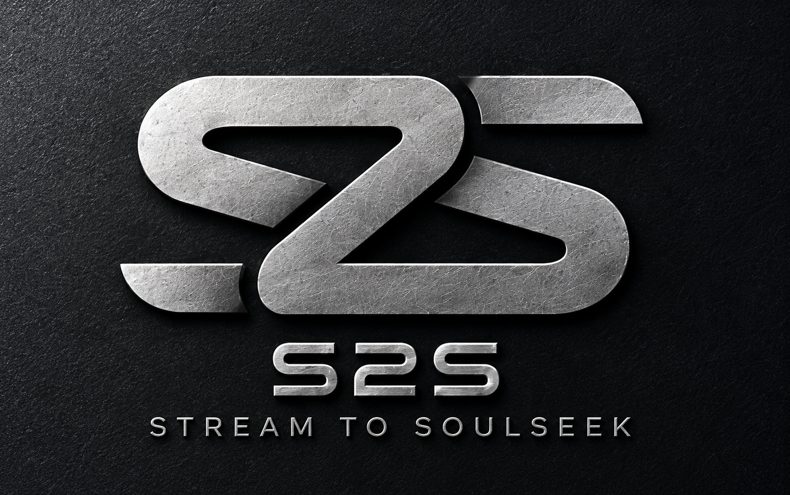

<p align="center">
  
</p>

# S2S — Stream to Soulseek

S2S is a Windows desktop application for building local music libraries from streaming-service playlists.
It uses playlist metadata to find matching recordings on Soulseek, presents the results for review, and
organizes approved downloads into a flat folder of verified audio files.

The application reads playlist metadata from Apple Music, Spotify and SoundCloud. Recording searches and
downloads run through [slskd](https://github.com/slskd/slskd), a Soulseek client with a local API.

## Project status

S2S is a development prototype undergoing user testing. Installation currently requires running from source;
a packaged release is not available.

| Playlist source | Status |
| --- | --- |
| Apple Music | Implemented using an unofficial API; live integration under testing |
| Spotify | Embedded sign-in through SpotAPI, or public playlist links without sign-in; public metadata verified, real account testing pending |
| SoundCloud | Opt-in embedded sign-in for account-owned playlists; public metadata verified, real account testing pending ([details](docs/SOUNDCLOUD.md)) |

The offline test suite covers matching, download approvals, file organization, state management, and the
desktop interface, including a simulated end-to-end run. These tests use synthetic data and simulated
services; they do not establish that real account sign-in or live downloads work end to end.

## Features

- Browse playlists and preview their tracks in a native desktop interface.
- Search Soulseek for matching recordings, with progress and individual track results.
- Search multiple tracks concurrently, using short initial passes and a longer search when too few uploaders
  are found. Aim for a match plus two other uploaders of the same file; availability varies.
- Review proposed files, alternatives, audio quality, and unresolved matches before downloading.
- Automatically switch a download that is stuck in an uploader's queue to another uploader of the same file.
- Configure matching rules and save reusable rule sets.
- Verify completed downloads and copy them into a flat tracklist folder.
- Check the finished folder against the playlist in order.
- View a downloaded file's spectrogram with an estimated frequency cutoff to help assess its audio quality.
- Track failed transfers, review replacement sources, and resume the most recent import.
- Inspect every playlist track in import history, filter outstanding work, and export remaining tracks to CSV.
- Start another import without reconnecting accounts or losing import history.

By default, S2S prefers an exact recording match, then an extended version of the same recording if needed.
It excludes radio edits, live recordings, and `[Mixed]` tracks, and prefers MP3 320 kbps CBR followed by FLAC.
These preferences are configurable. Different remixes, remixers, and incompatible VIP versions remain
ineligible regardless of audio quality.

## Requirements

- Windows and Python 3.11 or newer.
- A local slskd installation and a Soulseek account.
- FFmpeg's `ffprobe` utility for audio verification.
- FFmpeg's `ffmpeg` utility for the optional spectrogram view.
- An account with a supported playlist source.

Each user connects their own accounts. Credentials, authenticated sessions, and music are not included in
this repository.

## Installation

```powershell
git clone https://github.com/xanman04/stream2soulseek.git
cd stream2soulseek
py -m venv .venv
.\.venv\Scripts\python.exe -m pip install -e ".[dev]"
```

Follow the [slskd setup guide](docs/SETUP.md) to install slskd and configure its download location. S2S manages
the local slskd process and retains a successful Soulseek login for subsequent sessions. The application
finds `ffprobe` on `PATH`, or you can select its location in Settings.

Launch S2S:

```powershell
.\.venv\Scripts\python.exe -m s2s.app
```

Or double-click `run-s2s.cmd` in Explorer. Start S2S from Explorer or a normal PowerShell / Windows Terminal
window, not from the built-in terminal of another desktop app: some packaged apps make Windows redirect S2S's
data folder (settings, saved logins, history) to their own private copy. S2S warns when this happens.

The installation also provides an `s2s` GUI entry point.

## Import workflow

Connect a supported service from the sidebar (or paste a public Spotify playlist link on step 1), then follow
the six steps. Ctrl+1 … Ctrl+6 jump between steps.

For SoundCloud, first enable **web sign-in** on its account page. This initial integration lists your own
playlists, including accessible private playlists; liked playlists and liked tracks are not included.

1. **Choose playlist.** Select a connected source and playlist, or paste a Spotify playlist link. Preview,
   filter, or sort its tracks before continuing. Preview sorting does not change the source playlist order.
2. **Choose tracklist folder.** Select the final destination for verified audio files. Each import can use a
   separate library folder.
3. **Find on Soulseek.** The search starts as soon as you arrive. Results read plainly ("Found · exact",
   "Check needed: length differs by 60 s", "Not found") with live progress and counts.
4. **Review & confirm.** A summary shows how many tracks are ready, need a look, or were not found; filters
   and **Next to check** take you straight to the ones that need attention. Confident matches are ticked,
   flagged ones are not. The details panel explains why a file was chosen or flagged and lists alternatives.
   Downloads begin only after you confirm the exact files with **Download N tracks…**; the confirmation also
   lists, in grey, the other uploaders of the same files that S2S may switch to.
5. **Downloads & import.** The queue lists every track with a plain status ("In folder ✓", "Downloading 42%",
   "Waiting on uploader"). Verified files are copied into the tracklist folder automatically. Any track that
   fails, is declined, waits on its uploader for more than 10 minutes, or does not pass its check also appears
   in **Needs attention** underneath, with what happened in plain words and the buttons that fix it (Find
   another source, Retry, Check again, Cancel) while the rest keeps downloading. A replacement still needs your
   confirmation.
6. **Check files.** Compares the tracklist folder with the playlist in order, lists anything missing or
   unexpected, and opens a track's spectrogram to check its real quality. The missing list can be exported.
   **Start another playlist** is here.

**Spectrogram** is available for files in your folder in Check files. The frequency cutoff is an
estimate for manual inspection; it does not prove a file's encoding history or automatically reject a track.

**Import history / outstanding tracks** is available from the File menu and step 5. It preserves the full
playlist view, including tracks without an eligible match, files not selected for download, failures, and
queued transfers. Download totals refer to approved tracks; they do not imply that the entire playlist has
been imported. The outstanding list can be exported for later searches.

**Previous import recorded** refers to an earlier import into the selected tracklist folder. New searches
skip those tracks only while the recorded file still exists. History identifies missing destination files.

### Download folders and the final library

S2S uses two separate locations:

| Location | Purpose |
| --- | --- |
| **Soulseek downloads folder** | Receives original downloads in slskd's peer and source-folder structure. Also holds archived source folders. |
| **Tracklist folder** | Contains the verified audio files together, without artist, album, or peer subfolders. |

The tracklist folder must be separate from the Soulseek downloads folder and its archive. Imported files use
`Title (Version) - Artist.ext`. Existing destination files are not overwritten; conflicts and verification
failures are reported for review.

Automatic import is enabled by default. Once a peer's transfers and imports satisfy the archive checks,
S2S moves its source folder into the configured archive beneath the Soulseek downloads folder (`OLD` by
default). Identical archive files are deduplicated; conflicting files are retained under distinct names.
Failed or conflicting imports keep the source folder available for inspection.

### Failed and declined transfers

Failed transfers can be retried. When an uploader declines a download, **Find another source** opens a review
of eligible alternatives for the affected tracks. Replacement downloads require a new confirmation.

S2S shares no folders by default. Optional sharing is configured in **Settings > Sharing**; selected folders
are visible to other Soulseek users. See the [setup guide](docs/SETUP.md) for details.

## Account and file handling

- Stored API tokens and login credentials use Windows DPAPI protection under
  `%LOCALAPPDATA%\S2S\secrets`, outside the repository.
- Streaming-service sign-in takes place on the service's own pages inside the application. Browser profiles
  are temporary; accepted sessions are stored separately with Windows protection. Sign-out removes the
  selected service's local session without disconnecting the other services.
- Download approvals bind the selected peer, remote file, size, and destination. Changing a selection
  requires a new approval; changing matching rules requires a new search.
- Import verification checks file size, codec, and bitrate before copying audio into the final library.

Use S2S only to obtain or share material you are authorized to access or distribute. The playlist integrations
use unofficial website APIs; S2S is not affiliated with the streaming services or Soulseek.

## Queued downloads

Switching is automatic. When an uploader has sent nothing for 5 minutes, S2S tries another uploader of the
same file, with at most three attempts active per track. It only switches to a copy of the very recording you
approved: the same match (an exact match is never swapped for an extended mix), the same version, the same
format and quality, and the same length within 3 seconds or the same byte size. These other uploaders are listed
in the confirmation, and nothing outside that list is ever requested. Once a source starts sending, the other
attempts are cancelled without deleting partial files. Only the finished, verified file is copied to the
tracklist folder. For downloads confirmed before this version, **Switch to another uploader…** in Step 5 offers
the same.

Keep Step 5 open for automatic verification, import, archiving, and switching checks. Soulseek downloads
continue independently when S2S is closed or another page is open; automatic processing resumes when Step 5
is opened again. This behavior has offline test coverage; live queue recovery remains under user testing.


## Known limitations

- Peer availability and upload queues can delay or prevent downloads. Other uploaders are not
  guaranteed, and unresolved results may require a later search or manual investigation.
- Archive handling needs additional protection against pre-existing nested symbolic links and Windows
  junctions. Use ordinary folders for downloads and archives in the current prototype.
- Live authentication, playlist retrieval, transfers, and filesystem behavior require further end-to-end
  testing across account and slskd configurations.

## Development

S2S uses Python, PySide6/Qt widgets, and a local slskd API connection. Playlist integrations implement
[`PlaylistSource`](src/s2s/sources/base.py) and are registered through `AppContext.playlist_sources()`.

Run the offline test suite from the repository root:

```powershell
.\.venv\Scripts\python.exe -m pytest -q
```

See [AGENTS.md](AGENTS.md) for development context and project constraints. Keep credentials, session data,
music, and personal playlist exports out of commits.
