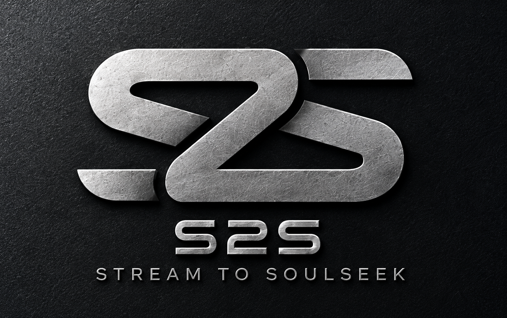
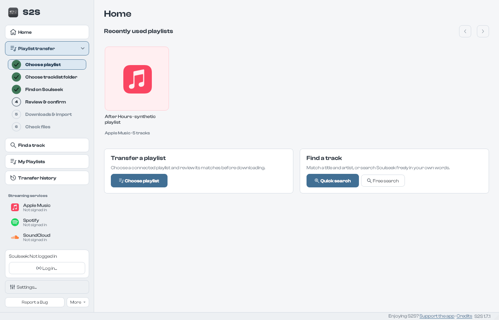
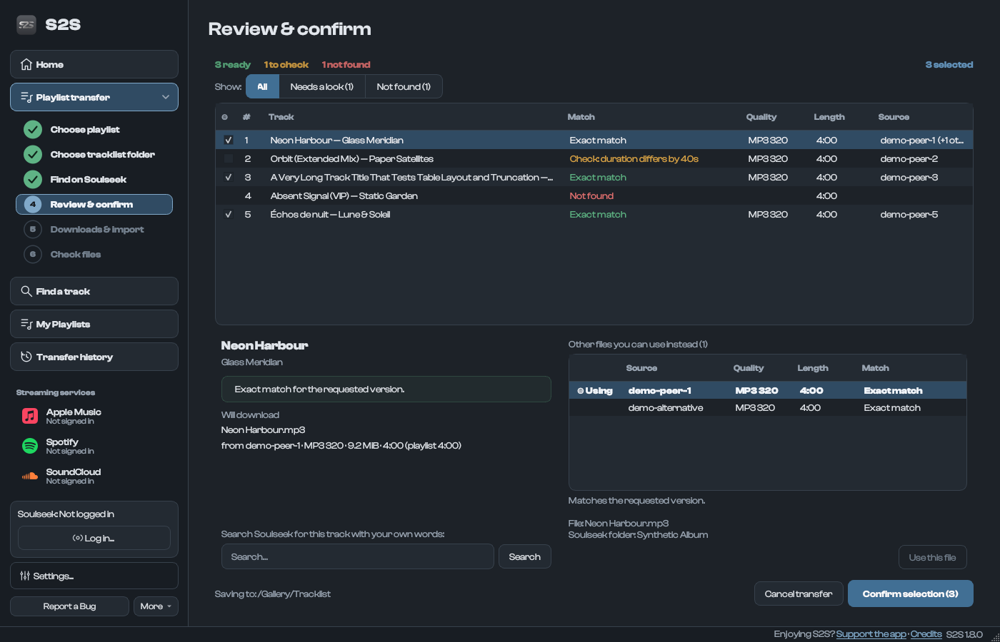
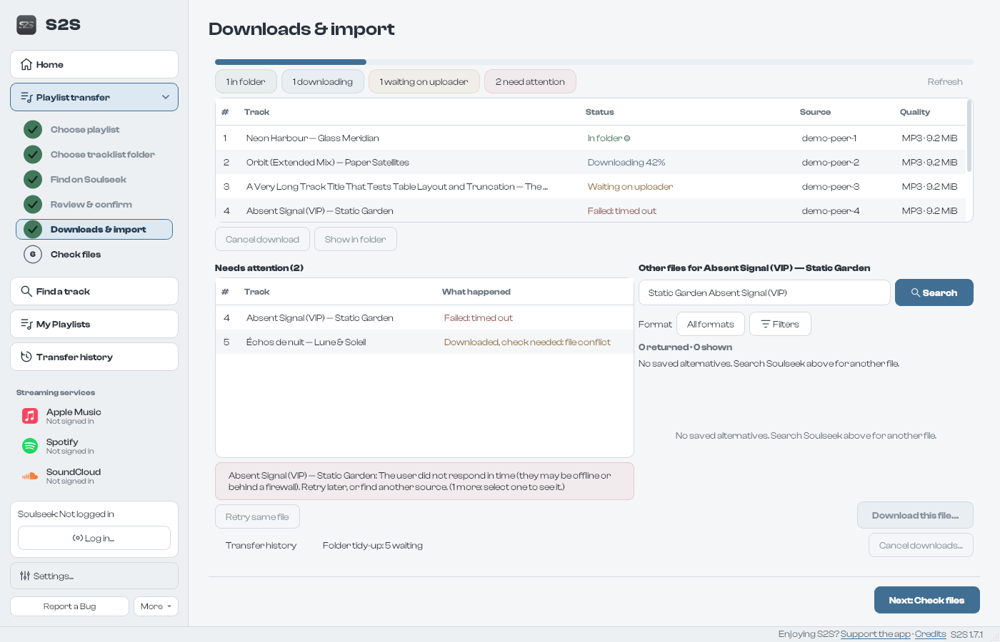
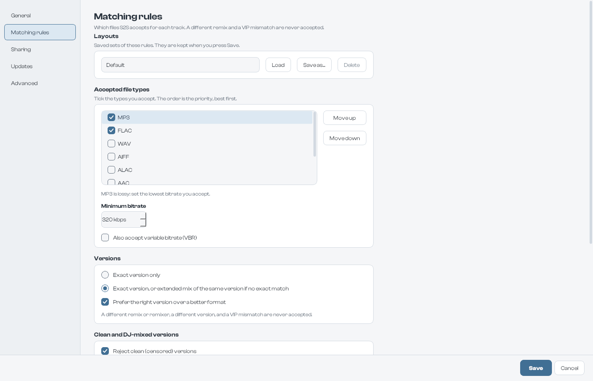

<p align="center">
  
</p>

# S2S — Stream to Soulseek

S2S is a desktop app for Windows and macOS that turns streaming-service playlists into local music
libraries. Choose a playlist, find its recordings on Soulseek, review the proposed files and confirm the
downloads. Finished tracks are checked and collected into one folder for your music player or DJ software.

Apple Music, Spotify and SoundCloud supply **playlist metadata**. Audio downloads come from Soulseek
through the bundled [slskd client](https://github.com/slskd/slskd).

## What S2S does

- Connects Apple Music, Spotify and SoundCloud playlists to one search and download workflow.
- Matches recording versions, remixes and audio preferences, with uncertain results flagged for review.
- Shows alternative files and uploaders before you confirm downloads.
- Checks completed files and collects them into a folder without artist, album or uploader subfolders.
- Records missing and unsuccessful tracks so you can return to them later.
- Reuses recent search candidates across app restarts and overlapping playlists.
- Browses local tracklist folders in **My Playlists**, with track details and total runtime.
- Finds single tracks with **Quick search** (ranked by your matching rules) or **Free search** (raw results).
- Lets you listen to each finished file with a spectrogram before you trust it.
- Updates itself from signed releases, with a Stable channel for everyone and an optional Preview channel for sponsors.

S2S does not download audio from the streaming services. No download starts until you confirm a selection.

## Screenshots

These use made-up playlists and uploaders; no real music or accounts are shown.

<p align="center">
  
  
</p>
<p align="center">
  
  
</p>

## Download and install

Download the installer from [the latest release](https://github.com/xanman04/stream2soulseek/releases/latest).
Use the files attached under **Assets**, rather than GitHub's automatically generated source-code archives.
Python, slskd and FFmpeg are included; packaged releases need no separate installation of those tools.

| Computer | Installer |
| --- | --- |
| Windows 10 (1809+) or Windows 11, x64 | `S2S-<version>-windows-x64-setup.exe` |
| Mac with Apple silicon (M1 or newer), macOS 14.4+ | `S2S-<version>-macos-arm64.dmg` |
| Intel Mac, macOS 14.4+ | `S2S-<version>-macos-x64.dmg` |

**Windows:** Run the installer, then open S2S from the Start menu. It installs for your user account without
administrator rights and includes an uninstaller.

**macOS:** Open the disk image, drag S2S into Applications, and launch it from there. **Apple menu → About
This Mac** identifies your chip and macOS version.

Windows installers are unsigned and Mac builds are not notarized. Before overriding a first-launch
warning, [verify the SHA-256](docs/INSTALL.md#verify-a-download) against the checksum on the release page.

- **Windows:** If SmartScreen shows **Windows protected your PC**, select **More info → Run anyway**
  if offered. See the [Windows steps](docs/INSTALL.md#windows) if that option is missing.
- **macOS:** After trying to open S2S from Applications, go to **System Settings → Privacy & Security**
  and select **Open Anyway**. See the [Mac steps](docs/INSTALL.md#macos) for the full sequence.

Live Mac testing has covered successful sign-in, searching, reviewing selections and downloading files
from Soulseek. Verification and copying into the final tracklist folder still need a live retest following
recent fixes. Windows, Apple silicon and Intel Mac builds also run automated tests and packaged app/browser
checks before publication.

## Connect your accounts

Start S2S and sign in to Soulseek when prompted. S2S uses a default **Soulseek downloads folder** for
incoming files, which you can change in Settings. Close any other Soulseek client using the same account.

Open a streaming service in the sidebar to connect it. Sign-in takes place inside S2S on the service's
own website; saved sessions can be reused on later launches.

| Playlist source | Available workflow |
| --- | --- |
| **Apple Music** | Sign in, browse library playlists and preview their tracks. |
| **Spotify** | Sign in to browse playlists, or paste a public Spotify playlist link in **Choose playlist** without signing in. |
| **SoundCloud** | Sign in to browse your own playlists and playlists you saved from other users, or paste a playlist link in **Choose playlist**. The account's separate Liked Tracks feed is not included. See the [SoundCloud guide](docs/SOUNDCLOUD.md). |

These integrations use unofficial website APIs and may need updates when the services change. Account
permissions, library access and unavailable tracks can affect the playlist data returned.

## From playlist to files

S2S opens on **Home**, with recently used S2S playlists and entry points for playlist
transfers and individual tracks. The playlist steps expand beneath **Playlist transfer** in the sidebar;
returning Home preserves the current session. Saved unfinished transfers remain available in the sidebar.
Playlist covers come from the connected services and are cached locally. If a service has no cover or its
image cannot be loaded, S2S shows that service's mark instead. Artwork does not affect track matching.

1. **Choose playlist.** Select a source and playlist, then inspect its tracks. Filtering and sorting the
   preview do not modify the original playlist. Sortable lists cycle through ascending, descending and
   original order when you click a column heading.
2. **Choose tracklist folder.** Select the final folder where the verified tracks should end up.
3. **Find on Soulseek.** Follow the search progress and see which tracks were found, flagged or unresolved.
   Use **Add a song…** to include a track by title and artist in the same transfer.
4. **Review & confirm.** Inspect filenames, versions, formats, quality and alternatives. Confident matches
   are selected automatically under the default rules; flagged matches need your attention. Confirm the
   exact selection before any downloads begin.
5. **Downloads & import.** Monitor downloads and automatic file checks. **Needs attention** explains
   failed, declined or long-waiting transfers and offers recovery actions. Replacements need your approval.
6. **Check files.** Compare the folder against the playlist and inspect each selected track in a permanent
   spectrogram and audio-player dashboard. Selection stays paused; click the spectrogram to seek and play,
   or use the playback controls. **Expand** opens a larger view of the same track. File details include the
   original source filename and available audio metadata. Queued or failed downloads offer alternatives and
   custom Soulseek searches, with confirmation required before a replacement downloads. Export missing tracks
   when needed, and choose **Done** to begin another playlist.

After confirming downloads, steps 1–4 are locked for that run. **Cancel downloads** stops unfinished
transfers and starts over; files already imported stay in the tracklist folder. Open **Transfer history**
from the sidebar to browse completed and unfinished work, resume a transfer, or export its unfinished tracks.

### Two folders, two purposes

| Folder | What it contains |
| --- | --- |
| **Soulseek downloads folder** | Original completed downloads in uploader/source subfolders, plus archived source folders. |
| **Tracklist folder** | The checked audio files together, without artist, album or uploader subfolders. |

Choose separate locations: the tracklist folder cannot be inside the Soulseek downloads folder or its
archive. You can use a different tracklist folder for each playlist. Files are named
`Title (Version) - Artist.ext`; existing files are not overwritten. Unfinished transfers are kept in
S2S's application data folder, separate from both locations.

S2S continues checking saved transfers in the background while the app is running, including when you
leave **Downloads & import**. Open that page to monitor a transfer or resolve files that need attention.
When enabled, archiving moves processed source folders into `OLD` beneath the Soulseek downloads folder.
Use ordinary folders for downloads and archives; nested symbolic links and Windows junctions need further
hardening. Failed checks and file conflicts require attention before the affected source folder is archived.

## Find a track

**Find a track** works independently of the playlist currently open. **Quick search** accepts a title, artist
and optional version, then ranks files using the normal matching rules. **Free search** shows the raw Soulseek
files in response order, including formats and versions that Quick search would exclude. It makes no claim
that a returned file matches a particular recording.

Free search starts with **All formats** and no active filters. The Format dropdown accepts multiple formats;
**Filters** narrows filename, uploader, bitrate, duration, size and upload-slot availability locally. Active
formats and filters appear as removable chips beside the controls, wrapping when needed. Remove a chip to
clear that setting, or clear all filters to restore the returned list. Column headings cycle ascending,
descending and original order.

**Review selection** shows the exact file and asks for its final folder before confirmation. Confirmed
individual downloads get their own saved transfer, without replacing the active playlist. Free search keeps
the selected file's original basename and does not enforce playlist audio-format or version rules when
copying it. Completion, advertised size, source-folder confinement and no-overwrite checks still apply;
non-audio files are copied as unverified files and are never opened or executed automatically.

## Matching and review

By default, S2S prefers the exact requested recording, with an extended mix of the same version as a
fallback. Within those version preferences, MP3 320 kbps CBR is preferred over FLAC. You can change the
accepted formats, quality preferences and extended-mix behavior, then save them as reusable **Layouts**.

Different remixes and incompatible VIP versions are rejected. A radio edit or live recording is not a
substitute for the normal recording; when the playlist explicitly requests one, S2S searches for that
version. DJ-mixed playlist entries are searched as the standalone song by default; Review lets you choose
**Find the mixed version instead** when that is what you want. Clean versions are rejected by default
unless the playlist requests a clean version.

Uncertain matches are flagged so you can inspect the reason, compare alternatives, change the proposed
file or leave the track unselected. Filename and metadata matching cannot prove that the audio is the
correct recording. File checks inspect size, codec and bitrate; the spectrogram provides a further manual
check, rather than proof of a file's encoding history.

### Search speed and cached results

Searches overlap, but new requests are paced to limit the risk of Soulseek rate-limit bans. Recent search
candidates are cached locally for up to 12 hours, including across restarts, and evaluated against your
current matching rules when reused. Ready search requests take turns so waiting tracks are not repeatedly
overtaken by newer requests.

Caching helps repeated or overlapping playlists. A fresh playlist of unrelated tracks still requires
network searches and can take several minutes. Finding candidates does not establish that their uploaders
are still online or willing to transfer the files.

### Downloads that need attention

Failed, declined and long-waiting transfers appear under **Needs attention**. A transfer waiting five
minutes offers **Choose another uploader…**. S2S tries only the alternative files you approve; choosing
which files are allowed remains a separate step from finding them. Approved alternatives can be tried at
the interval you choose, which defaults to 45 seconds. Available backup counts vary by recording.

## Settings and menus

**Settings** (bottom of the sidebar) has five pages: **General** (automatic import, the extended search
timeout), **Matching rules** (accepted formats, version handling and saved Layouts), **Sharing** (folders
you choose to share with Soulseek), **Updates** (Stable or sponsor Preview) and **Advanced** (the close
button, download folders, ffprobe and the slskd connection).

The **More** menu in the sidebar holds **Check for updates**, **Help** (user guide, What's new, open the log
folder, copy diagnostics, report a bug), **Support S2S**, **Credits**, **About** (version, licence and notices)
and **Quit**. Quitting asks first only when transfers would be interrupted. By default the window's close button
keeps S2S running in the system tray while transfers are in progress; turn that off under
**Settings → Advanced** to make it quit instead. S2S reopens at the size and place you left it.

The first time S2S starts, a short welcome card on Home explains the steps. After you update to a new
stable release, **What's new** shows that version's changes once.

## Updates and problem reports

S2S checks for updates at startup and through **More → Check for updates**. It downloads the installer for
your computer, verifies its update signature, installs it and restarts. Settings, saved sessions and
history are kept. Active downloads can block installation.

The **Stable** channel is for everyone and needs no account. Eligible monthly GitHub sponsors can opt into
**Preview** under **Settings → Updates** to try upcoming builds first. A preview build has its own update
window and may contain bugs; Preview is not yet switched on in public builds (see
[sponsor preview updates](docs/sponsor-preview-updates.md)).

On Windows, a separate progress window stays open while S2S closes and the installer runs.
If an older copy cannot update itself, download and run the current installer from the releases page.

**Report a Bug** in the sidebar (also under **More → Help**) prepares a GitHub issue draft with your
description, reproduction steps, expected result, app/system versions and the recent scrubbed log.
**Help → Copy diagnostics** puts just the versions and a few non-personal settings on the clipboard. Logs are included automatically. Review the
report inside S2S, then open the draft in your browser; nothing is submitted automatically. You can copy
or save the report locally. Long reports are shortened for the draft and saved separately for manual
attachment. Reports posted to [GitHub issues](https://github.com/xanman04/stream2soulseek/issues) are public;
review screenshots and attachments before sharing, and never attach credentials or the application's data folder.

## Privacy and local data

Settings, import history, logs and cached search metadata stay in your user data folder:

- **Windows:** `%LOCALAPPDATA%\S2S`; credentials use Windows DPAPI protection.
- **macOS:** `~/Library/Application Support/S2S`; credentials use the login Keychain.

The embedded sign-in browser uses temporary profiles. Accepted sessions are stored separately; signing
out removes the selected service's saved session. S2S shares no music folders by default. Folders added
in **Settings → Sharing** become visible to other Soulseek users.

S2S has no analytics or telemetry. It contacts only these services:

- **Apple Music, Spotify and SoundCloud**, for the playlists of the accounts you sign in to.
- **Soulseek**, through the bundled slskd: your searches, your downloads, and any folders you chose to share.
- **GitHub**, to look for new releases and download the installer you approve. Problem reports open a draft in
  your browser that you review first; nothing is sent from the app.
- **A small sponsor-credits service run on Cloudflare**, when you open **More → Credits**. The request carries
  no personal data, although, like any web server, the service can see the connecting network address.

Use S2S only for material you are authorized to obtain or share. S2S is not affiliated with Apple,
Spotify, SoundCloud, Soulseek or slskd.

## Development

Source development requires Python 3.11+, a separate slskd installation, and FFmpeg (`ffmpeg` and
`ffprobe`). See [slskd setup](docs/SETUP.md) for configuration details; those manual installation steps
are for source development, not the downloadable app.

```sh
git clone https://github.com/xanman04/stream2soulseek.git
cd stream2soulseek
python -m venv .venv
```

Use `.venv/bin/python` on macOS or `.venv\Scripts\python.exe` on Windows:

```sh
<venv-python> -m pip install -e ".[dev]"
<venv-python> -m s2s.app
<venv-python> -m pytest -q
```

The sponsor service in `services/sponsor-worker` has its own tests (`node --test`, Node.js 22+).
`tools/ui_gallery.py` renders the real interface with made-up data for screenshots; see the
[UI gallery guide](docs/UI_GALLERY.md).

To build a standalone app on its target operating system:

```sh
<venv-python> -m pip install . -c packaging/constraints.txt pyinstaller pillow
<venv-python> packaging/build.py
```

The build downloads checksum-pinned tools, packages the app and licence notices, runs component and offline
browser checks, and rejects private runtime-state files from the bundle. It creates a Windows `.exe`
installer or macOS `.dmg`, plus a build-time `.sha256` file, in `dist/`. Windows builds also need
[Inno Setup 6](https://jrsoftware.org/isinfo.php); macOS apps must be built on a Mac.
The [release workflow](.github/workflows/release.yml) requires tests and builds on Windows, Apple silicon
and Intel Mac. Pushing a matching `v*` version tag triggers the workflow, which verifies all three installers
and their checksums before signing them for the in-app updater and publishing the release. The release
page contains the three installers and a checksum table; GitHub adds its source archives separately.
A manual workflow run builds artifacts without publishing. Live account and transfer testing remain
separate from these automated checks.

See the [changelog](CHANGELOG.md), [installation guide](docs/INSTALL.md) and
[release process](docs/RELEASING.md) for version history and maintenance details.

## Support development

S2S is free to use. You can support development with a monthly or one-time contribution through
[GitHub Sponsors](https://github.com/sponsors/xanman04). Monthly $10 sponsors can opt into public recognition
under **More → Credits** in the app. The sponsor Preview update channel is built into the app and is waiting for
its final live checks before it is switched on in public builds; Stable updates are available to everyone without
GitHub sign-in. See [sponsor preview updates](docs/sponsor-preview-updates.md) for how it works.

## License

S2S is licensed under the [GNU GPL v3 or later](LICENSE). Bundled components retain their own licences;
see [third-party notices](packaging/THIRD_PARTY_NOTICES.md).
